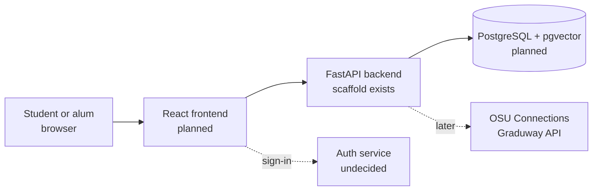

# BeaverLink Technical Design

## What Exists at This Commit

A FastAPI backend scaffold in `backend/` with one endpoint, `GET /health`, and one pytest test. There is no frontend, database schema, or login yet. CI (`.github/workflows/ci.yml`) runs `ruff` and `pytest` on every pull request to `dev` and `main`, and the frontend job is skipped until `frontend/package-lock.json` exists.

## Context

Students and alumni use a web app before and during OSU Alumni Association events. The app talks to a backend that stores profiles and surveys and ranks matches. Later, profiles may also be filled from OSU Connections (Gravyty's Graduway API).

## Interfaces and Contracts

| Endpoint | Status | Contract |
| --- | --- | --- |
| `GET /health` | Built | Returns `200` with `{"status": "ok"}`. Tested by `backend/tests/test_health.py`. |

Planned rule: all data goes through FastAPI; the frontend never queries the database directly.

## Data Model

None yet. Planned tables: users, profiles, events, surveys, matches. If embeddings are adopted, they go in a separate `profile_embeddings` table so they can be dropped without touching anything else.

## Deployment

**Production target (not yet agreed).** The walking skeleton (sign in, fill a profile, see one ranked match list) is planned to run as a hosted web app serving requests at a public URL by fall week 10. The hosting provider is not decided: the options are OSU-provided hosting or a cloud host, with managed PostgreSQL (Supabase is proposed in an open RFC). The account owner after handoff is not decided; the team proposes the OSU Alumni Association owns it. The partner, the OSU Alumni Association, has not yet agreed this target. Owner for closing this: Benjamin Smithynunta.

**Today.** The backend runs only locally (see README.md). Staging, rollback, and their dates are planned in `docs/risks.md`.

## Decisions Deferred on Purpose

Each has a proposed RFC, either in `docs/rfcs/` or in an open pull request:

- Database host and login library (Supabase Postgres with Better Auth, proposed).
- Profile data source and sign-in method (hybrid with swappable sources, proposed).
- Whether v1 matching uses stored embeddings (local model, separate table, off by default, proposed).

## Open Technical Questions

- Where does production run, and can it host a Node auth service next to FastAPI?
- Which OAuth providers can alumni use (Google, LinkedIn, OSU)?
- Does the CI Postgres image need extra extensions once migrations exist?
